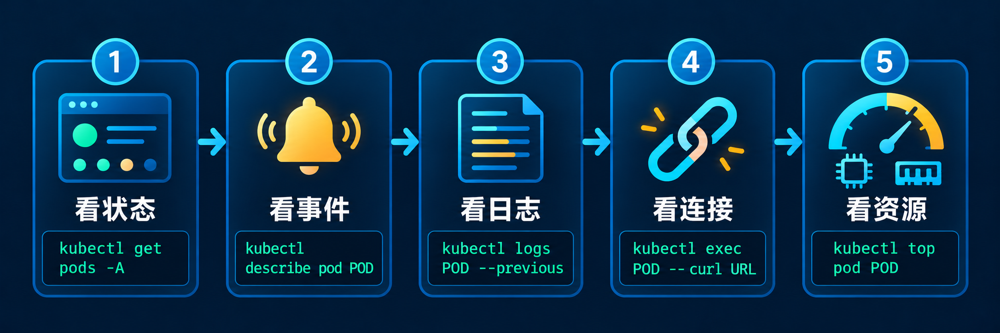
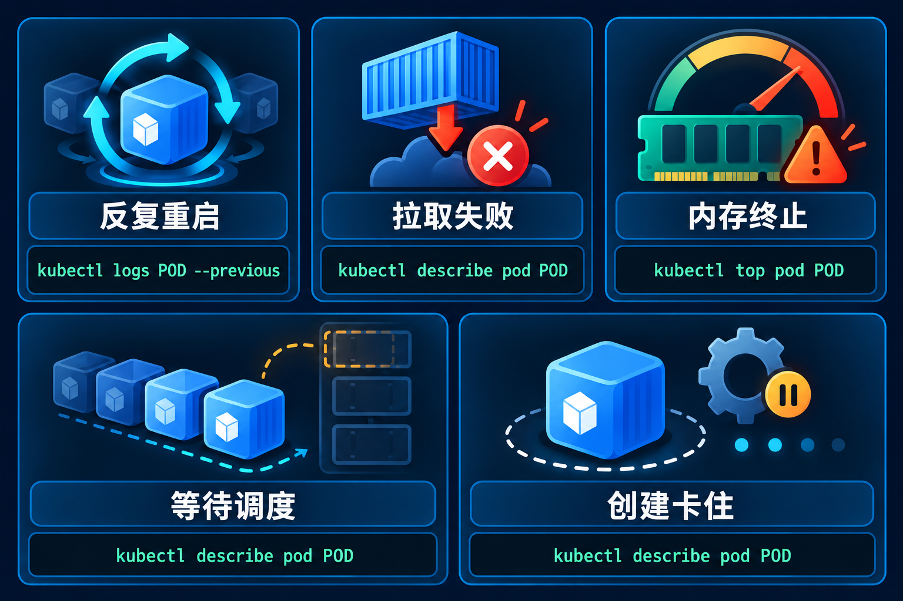
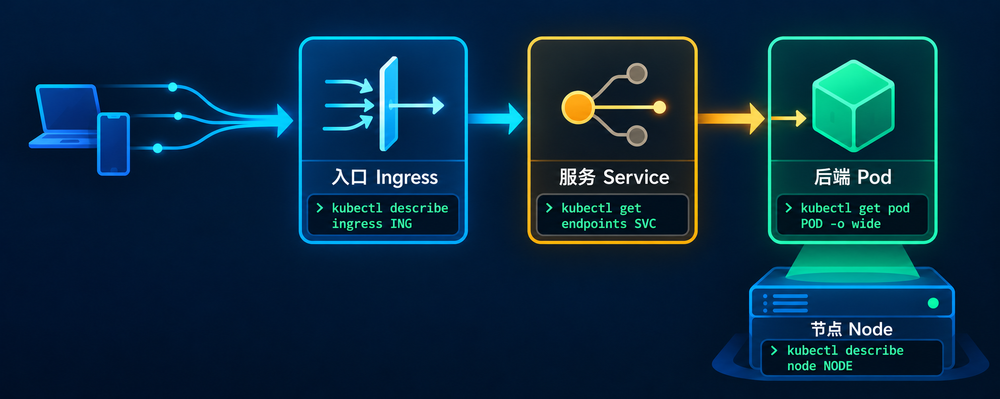

# K8s 出故障时，我会按这五步找原因

业务入口突然返回 502，群里很快会出现几种猜测：镜像没拉下来、Pod 崩了、Service 没后端，或者节点出了问题。这些猜测可能都对，但排查时先给故障贴标签，容易绕远路。

我会先确定故障卡在哪一层，再决定下一条命令。顺序固定：**看状态 → 看事件 → 看日志 → 看连接 → 看资源**。如果在前两步已经找到明确原因，就不用把后面的命令机械地跑一遍。

> 文中的 `<ns>`、`<pod>`、`<svc>` 等是占位符。配图里的 `POD`、`URL`、`ING`、`SVC`、`NODE` 也分别代表 Pod 名、访问地址、Ingress 名、Service 名和节点名；执行命令前要换成实际值。

## 先把故障缩小到一个对象



| 顺序 | 要回答的问题 | 从哪里看起 |
| --- | --- | --- |
| 1. 看状态 | 哪个 Pod 或 Node 异常？它现在处于什么状态？ | `kubectl get pods -A -o wide`、`kubectl get nodes` |
| 2. 看事件 | 调度器、kubelet 或控制器报告了什么？ | `kubectl describe pod <pod> -n <ns>` |
| 3. 看日志 | 容器启动后做了什么，退出前留下了什么？ | `kubectl logs <pod> -n <ns> --previous` |
| 4. 看连接 | 请求走到 Pod、Service、Ingress 的哪一段失败？ | `kubectl exec`、`curl`、`nslookup` |
| 5. 看资源 | CPU、内存、磁盘或进程数是否碰到限制？ | `kubectl top`、`kubectl describe node`、`df -h` |

先执行两条总览命令，记下异常对象所在的命名空间和节点：

```bash
kubectl get pods -A -o wide
kubectl get nodes
```

`STATUS` 只是入口。比如 `CrashLoopBackOff` 说明容器在反复启动，原因仍要看上一次退出状态和日志；`Pending` 要先看调度事件；`ImagePullBackOff` 时容器还没启动，查应用日志没有用。

找到对象后，把范围收紧。假设出问题的是 `production` 里的 `payment-api-7c9d`：

```bash
kubectl describe pod payment-api-7c9d -n production
kubectl events -n production --for pod/payment-api-7c9d
```

重点读 `Events`、容器的 `State` / `Last State`、`Reason`、`Exit Code`、探针配置和资源限制。`kubectl events` 不可用时，可以用 `kubectl get events -n production` 查看同一命名空间的事件。

## Pod 反复重启：先找上一次怎么退出



### CrashLoopBackOff

这个状态描述的是**重试结果**，不等于根因。应用配置错误、依赖服务不可用、内存不足、启动探针或存活探针设置不合适，都可能走到这里。

```bash
kubectl describe pod <pod> -n <ns>
kubectl logs <pod> -n <ns> --previous --tail=100
kubectl logs <pod> -n <ns> -c <container> --previous --tail=100
```

多容器 Pod 要用 `-c` 指定容器。`--previous` 取的是上一次容器实例的日志，排查刚重启的进程通常比看当前日志更有用。

我会按这几个线索继续分支：

| 线索 | 接下来查什么 |
| --- | --- |
| 日志里有配置或连接错误 | 对照 ConfigMap、Secret、环境变量和依赖地址 |
| `Last State` 显示 `OOMKilled` | 看容器内存限制和实际使用，再查内存增长原因 |
| 事件里有 `Unhealthy` | 检查探针路径、端口、超时和启动宽限时间 |
| 容器很快以非零码退出 | 核对启动命令、参数和镜像内文件 |

**不要只凭退出码 137 判定 OOM。** 它表示进程收到 `SIGKILL`，还要结合 `Reason: OOMKilled`、事件及节点记录确认。退出码 1 通常需要回到应用日志；143 对应 `SIGTERM`，也可能出现在正常终止过程中。

### OOMKilled

确认 `Reason` 后，再看是限制过低，还是程序内存确实在持续增长：

```bash
kubectl describe pod <pod> -n <ns>
kubectl get pod <pod> -n <ns> -o jsonpath='{.spec.containers[*].resources}'
kubectl top pod <pod> -n <ns> --containers
```

`kubectl top` 只能看到当下的使用量，短时峰值需要结合监控曲线。多容器 Pod 还应逐个核对容器的资源配置。确定是合理峰值超过限制，才调整 `limits.memory`；如果内存一直往上爬，先查泄漏或缓存策略。

如果 `kubectl top` 报错，先确认集群是否提供指标 API；拿不到实时指标不代表资源没有问题。

## Pod 没起来：事件通常比日志更有用

### ImagePullBackOff / ErrImagePull

容器尚未启动，先读拉取镜像的失败事件：

```bash
kubectl describe pod <pod> -n <ns>
kubectl get pod <pod> -n <ns> -o jsonpath='{.spec.containers[*].image}'
```

`manifest unknown` 往往指向镜像名或标签；`unauthorized` 先看仓库凭据和 `imagePullSecrets`；超时、DNS 或 TLS 错误则要从负责拉取镜像的 **Node** 到仓库这条链路查起。这里的网络路径和业务 Pod 访问 Service 的路径不同。

### Pending

先在 `Events` 找 `FailedScheduling`。调度器通常已经写出了它为什么选不到节点。

| 事件线索 | 核对位置 |
| --- | --- |
| `Insufficient cpu` / `Insufficient memory` | Pod 的 `requests`、节点可分配资源 |
| `untolerated taint` | 节点污点和 Pod 的 tolerations |
| affinity 或 selector 不匹配 | Pod 约束与节点标签 |
| unbound PVC | PVC、PV、StorageClass 及相关事件 |

```bash
kubectl describe pod <pod> -n <ns>
kubectl get nodes --show-labels
kubectl get pvc -n <ns>
```

别只看节点上的实时空闲内存。调度主要依据 Pod 的资源请求和节点可分配量；一个看起来还很空的节点，也可能因为请求量已占满而拒绝新 Pod。

### ContainerCreating 卡住

Pod 已经分配节点，却迟迟没有进入运行状态时，先看 `FailedMount`、创建 Pod sandbox 失败、CNI 报错等事件，再去对应节点查 kubelet 与容器运行时。

```bash
kubectl get pod <pod> -n <ns> -o wide
kubectl describe pod <pod> -n <ns>
kubectl get pvc -n <ns>
# 登录该 Pod 所在节点后执行
journalctl -u kubelet --since '15 min ago'
crictl ps -a
```

如果事件指出某个 Secret 或 ConfigMap 不存在，再检查那个对象。这样比把整个命名空间的配置逐个翻一遍快。

## Pod 正常，但请求不通：沿请求路径逐段查



### Service 不通

先确认 Service 选中了谁，再确认这些后端是否 Ready。下面的 `EndpointSlice` 是当前排查 Service 后端时很有用的对象；旧的 `Endpoints` 也可以一起看。

```bash
kubectl get svc <svc> -n <ns> -o yaml
kubectl get pods -n <ns> --show-labels
kubectl get endpoints <svc> -n <ns>
kubectl get endpointslices -n <ns> -l kubernetes.io/service-name=<svc>
```

- **没有后端**：核对 Service 的 selector、Pod 标签和 Ready 状态。
- **有后端但连接被拒绝**：核对 Service 的 `port`、`targetPort` 和应用实际监听端口。
- **直接访问 Pod IP 正常，走 Service IP 失败**：再检查节点上的 Service 转发组件、CNI 和网络策略。

从同一命名空间的调试 Pod 发起请求，分别访问 Pod IP 和 Service 名，能把问题缩到其中一段：

```bash
kubectl exec -n <ns> <debug-pod> -- curl -sv http://<pod-ip>:<target-port>
kubectl exec -n <ns> <debug-pod> -- curl -sv http://<svc>:<service-port>
```

### Ingress 返回 502 / 503

按 **Ingress → Service → 后端 Pod** 的顺序走。先看 Ingress 指向哪个 Service，再看该 Service 有没有可用后端，最后读 Ingress Controller 的日志。

```bash
kubectl describe ingress <ingress> -n <ns>
kubectl get svc <backend-svc> -n <ns>
kubectl get endpointslices -n <ns> -l kubernetes.io/service-name=<backend-svc>
kubectl logs -n <controller-ns> <controller-pod> --tail=100
```

Controller 日志里的连接拒绝、超时和找不到上游，分别指向不同方向。不要看到 502 就直接重启 Ingress Controller。

### DNS 解析失败

先区分是集群内 Service 名解析失败，还是外部域名解析失败：

```bash
kubectl exec -n <ns> <debug-pod> -- nslookup kubernetes.default.svc.cluster.local
kubectl exec -n <ns> <debug-pod> -- nslookup <external-domain>
kubectl get pods -n kube-system -l k8s-app=kube-dns
kubectl logs -n kube-system <coredns-pod> --tail=100
```

短名称解析不通时，用 `<svc>.<ns>.svc.cluster.local` 复测，并核对 Pod 的 DNS 配置。CoreDNS Pod 异常时再查它的日志和 ConfigMap。

## 一批 Pod 同时异常：把视线移到节点

当多个无关的 Pod 恰好落在同一节点上，而且同时出问题，就该检查 Node。`NotReady` 说明节点健康状态异常；Pod 是否以及何时被驱逐，还受容忍配置等因素影响。

```bash
kubectl describe node <node>
kubectl get pods -A -o wide --field-selector spec.nodeName=<node>
# 登录节点后执行
systemctl status kubelet
journalctl -u kubelet --since '30 min ago'
crictl info
systemctl status containerd
df -h
free -h
```

`MemoryPressure`、`DiskPressure`、`PIDPressure` 和 `Ready` 是优先看的条件。磁盘满要继续区分镜像存储、容器日志和 kubelet 数据目录；kubelet 或容器运行时失联，则要看它们自己的日志。

Linux 节点常见的默认硬驱逐阈值包括 `memory.available<100Mi`、`nodefs.available<10%`、`imagefs.available<15%`。这些是默认配置，集群可以改；排查时以节点实际 kubelet 配置和事件为准。磁盘压力下 kubelet 会先尝试回收资源，回收不够才可能驱逐 Pod。

## 值班时可以照着走的速查表

| 看到的现象 | 第一条有效线索 | 后续方向 |
| --- | --- | --- |
| `CrashLoopBackOff` | `Last State` 和 `logs --previous` | 应用、配置、探针、OOM |
| `ImagePullBackOff` | Pod 的拉取镜像事件 | 镜像标签、仓库认证、节点到仓库的网络 |
| `OOMKilled` | `Reason`、限制和内存曲线 | 合理峰值还是持续增长 |
| `Pending` | `FailedScheduling` | 请求量、污点、调度约束、PVC |
| `ContainerCreating` | Pod 事件 | 挂载、CNI、kubelet、容器运行时 |
| Service 不通 | EndpointSlice 和 Pod Ready 状态 | selector、端口、转发链路 |
| Ingress 502 / 503 | Controller 日志与 Service 后端 | 上游连接、端口、超时 |
| DNS 不通 | 集群域名与外部域名的解析结果 | Pod DNS 配置、CoreDNS |
| Node `NotReady` | Node Conditions 与 kubelet 日志 | 节点资源、运行时、API 连接 |

退出码可以帮忙缩小范围，但最终仍要和 `Reason`、事件及日志一起看：

| 退出码 | 常见含义 | 排查提醒 |
| --- | --- | --- |
| 0 | 进程正常退出 | 对常驻服务，继续查为何没有保持运行 |
| 1 | 应用返回错误 | 看启动日志和配置 |
| 137 | 收到 `SIGKILL` | 核对是否 `OOMKilled`，不要只看数字 |
| 139 | 段错误 | 查原生库、内存访问和崩溃转储 |
| 143 | 收到 `SIGTERM` | 对照滚动更新、删除操作和探针事件 |

事件里的 `FailedScheduling`、`FailedMount`、`Unhealthy`、`BackOff` 和 `Evicted` 也值得优先看。它们分别把排查方向指向调度、挂载、探针、重试和节点驱逐。

业务镜像里没有 shell 或 `curl` 时，可以给运行中的 Pod 加临时调试容器；想单独测试 Service，也可以先做端口转发：

```bash
kubectl debug -it <pod> -n <ns> --image=nicolaka/netshoot --target=<container>
kubectl port-forward -n <ns> svc/<svc> 8080:<service-port>
```

最后留一个习惯：**先记下状态和事件，再改配置。** 重启或扩容也许能暂时恢复服务，但如果没留下退出原因、事件和时间点，下次故障还得从头猜。

## 参考资料

- [Kubernetes 官方文档：调试运行中的 Pod](https://kubernetes.io/docs/tasks/debug/debug-application/debug-running-pod/)
- [Kubernetes 官方文档：调试 Service](https://kubernetes.io/docs/tasks/debug/debug-application/debug-service/)
- [Kubernetes 官方文档：节点压力驱逐](https://kubernetes.io/docs/concepts/scheduling-eviction/node-pressure-eviction/)
