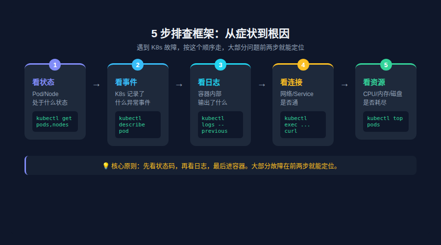
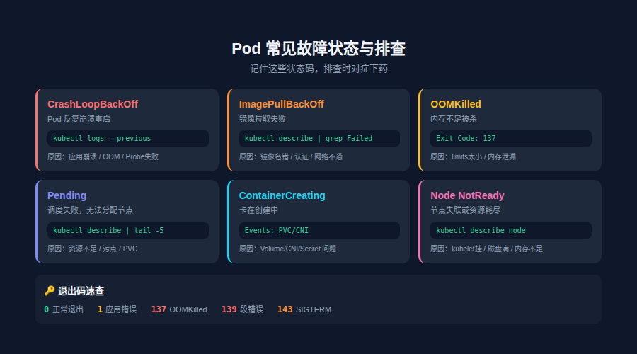
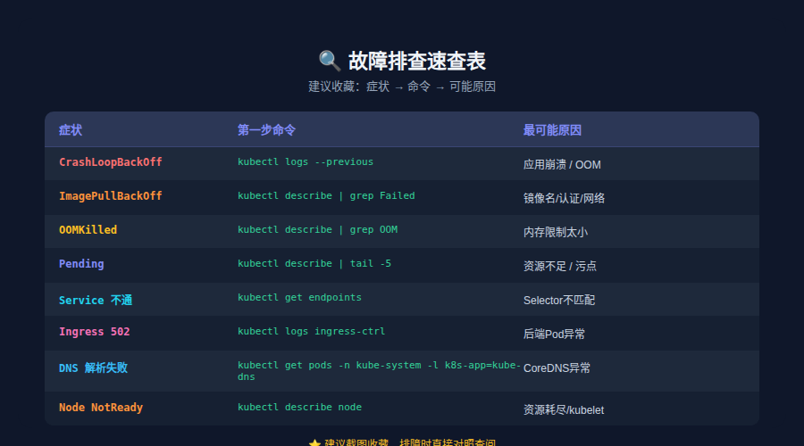

# K8s 故障排查手册：Pod 崩溃、镜像拉取失败、网络不通

> 原文：[微信公众号文章](https://mp.weixin.qq.com/s/QutFzrFYAkoWY-wxLv0rWQ)

## 开篇场景

凌晨 3 点，告警把你炸醒：

```text
[CRITICAL] Pod api-server-7d8f-x2k4j is CrashLoopBackOff
[CRITICAL] Pod worker-cron-9abc-m3n1p is ImagePullBackOff
[WARNING] Node node-03 status: NotReady
```

你打开终端，面对十几个命名空间、上百个 Pod，脑子还是糊的——**从哪开始查？**

K8s 故障排查的痛点不是"没有工具"，而是工具太多、信息太散。`kubectl describe` 输出几百行，Events 一堆 Warning 不知哪个关键，日志跨多个容器……**你需要的是一套排查框架，而不是一堆零散命令。**

这篇文章给你一个**从症状到根因的排查路径**，外加一份可以收藏的速查表。

## 一、故障排查方法论：5 步排查框架

遇到 K8s 故障，不要急着一头扎进日志。按这个顺序走：

| 步骤          | 做什么             | 核心命令                              |
| ----------- | --------------- | --------------------------------- |
| **1. 看状态** | Pod/Node 处于什么状态 | `kubectl get pods, nodes` |
| **2. 看事件** | K8s 记录了什么异常事件 | `kubectl describe pod <name>` |
| **3. 看日志** | 容器内部输出了什么 | `kubectl logs <name> [--previous]` |
| **4. 看连接** | 网络/Service 是否通 | `kubectl exec ... curl/nslookup` |
| **5. 看资源** | CPU/内存/磁盘是否耗尽 | `kubectl top` / `df -h` |

> **核心原则**：先看状态码，再看日志，最后进容器。大部分故障在前两步就能定位。



### 一个典型的排查路径

```bash
# Step 1: 发现问题 Pod
kubectl get pods -n production
# NAME                      READY   STATUS             RESTARTS   AGE
# api-server-7d8f-x2k4j    0/1     CrashLoopBackOff   7          12m

# Step 2: 看事件，找根因
kubectl describe pod api-server-7d8f-x2k4j -n production | grep -A5 Events
# Last State: Terminated with exit code 137 (OOMKilled)

# Step 3: 看日志确认
kubectl logs api-server-7d8f-x2k4j -n production --previous | tail -20
# java.lang.OutOfMemoryError: GC overhead limit exceeded

# Step 4: 修复 → 提高内存限制
kubectl set resources deploy api-server -n production \
  --limits=memory=1Gi --requests=memory=512Mi
```

**5 分钟定位，1 条命令修复。** 这就是框架的价值。

## 二、Pod 常见故障与排查

### 2.1 CrashLoopBackOff（最常见）

**症状**：Pod 反复启动 → 崩溃 → 重启，`RESTARTS` 计数不断增长。

**常见原因**：

- 应用启动崩溃（配置错误、依赖缺失）
- **OOMKilled**（内存不足被杀）
- 健康检查失败（Liveness Probe 太激进）
- 启动依赖未就绪（数据库没起来，应用就挂了）

**排查命令**：

```bash
# 1. 查看上次崩溃的日志（--previous 是关键！）
kubectl logs <pod-name> --previous

# 2. 查看退出码
kubectl describe pod <pod-name> | grep -A5 "Last State"
# 退出码对照：
# 0 = 正常退出（可能是健康检查问题）
# 1 = 应用错误
# 137 = OOMKilled（被 SIGKILL）
# 139 = 段错误（SIGSEGV）
# 143 = 被 SIGTERM（正常关闭信号）

# 3. 查看资源使用
kubectl top pod <pod-name>
```

**修复参考**：

| 退出码     | 根因                | 修复方向                       |
| ------- | ----------------- | -------------------------- |
| **137** | OOMKilled         | 提高 resources.limits.memory |
| **1**   | 应用异常              | 查日志修复代码/配置                 |
| **0**   | Liveness Probe 失败 | 调大 initialDelaySeconds     |

### 2.2 ImagePullBackOff / ErrImagePull

**症状**：Pod 卡在 `ImagePullBackOff`，容器根本没启动。

```bash
kubectl describe pod <pod-name> | grep -A3 "Failed"
# Failed to pull image "my-registry/app:v2": rpc error:
# code = Unknown desc = Error response from daemon: manifest unknown
```

| 原因         | 排查                                                           | 修复                  |
| ---------- | ------------------------------------------------------------ | ------------------- |
| 镜像名/Tag 写错 | `kubectl get pod -o jsonpath='{.spec.containers[*].image}'` | 修正镜像名 |
| 镜像仓库需要认证 | `kubectl describe pod \| grep -i secret` | 创建 imagePullSecrets |
| 私有仓库不可达 | 在 Node 上 `curl <registry>` | 检查网络/DNS |
| 镜像太大拉取超时   | Events 中看 Timed out                                          | 配置更大的拉取超时           |

### 2.3 OOMKilled

**症状**：Pod 运行一段时间后突然被杀，重启计数 +1。

```bash
# 确认是否 OOM
kubectl describe pod <pod-name> | grep -E "(State|Reason|Exit Code)"
# Reason: OOMKilled
# Exit Code: 137

# 查看 Pod 内存限制
kubectl get pod <pod-name> -o jsonpath='{.spec.containers[0].resources}' | jq .

# 实时监控内存
kubectl top pod <pod-name> --containers
```

> **常见坑**：JVM 不认识 cgroup 限制，默认用 1/4 物理内存做堆。用 `-XX:+UseContainerSupport -XX:MaxRAMPercentage=75.0`（Java 10+）。Sidecar 容器和主容器共享 Pod 内存限制，Sidecar 泄漏会拖垮主容器。

### 2.4 Pending（调度失败）

**症状**：Pod 一直 `Pending`，根本没被分配到节点。

```bash
kubectl describe pod <pod-name> | tail -10
# Events:
# Warning FailedScheduling ... 0/5 nodes are available:
# 3 Insufficient memory, 2 node(s) had untolerated taint
```

| 原因      | 关键词                       | 修复                   |
| ------- | ------------------------- | -------------------- |
| 资源不足    | Insufficient memory/cpu   | 扩节点 or 降 requests    |
| 污点容忍    | untolerated taint         | 加 toleration or 去污点  |
| 调度约束    | nodeSelector/affinity 不匹配 | 检查标签                 |
| PVC 未就绪 | pod has unbound claims    | 检查 StorageClass / PV |

### 2.5 ContainerCreating 卡住

**症状**：Pod 通过了调度，但一直卡在 `ContainerCreating`。

```bash
# 重点检查：
# 1. Secret/ConfigMap 是否存在
kubectl get secret <secret-name> -n <ns>
kubectl get configmap <cm-name> -n <ns>

# 2. PVC 是否 Bound
kubectl get pvc -n <ns>

# 3. 登录 Node 看 kubelet 日志
journalctl -u kubelet --since "10 min ago" | grep <pod-name>
crictl ps -a | grep <pod-name>
```



## 三、Service / Ingress 网络故障排查

### 3.1 Service 无法访问

**症状**：Pod 正常运行，但通过 Service IP 访问不通。

```bash
# Step 1: 确认 Service 有 Endpoints
kubectl get endpoints <svc-name> -n <ns>
# 如果 Endpoints 是空的，说明 Selector 没匹配到 Pod

# Step 2: 检查 Selector 是否匹配
kubectl get pods -n <ns> --show-labels
kubectl get svc <svc-name> -n <ns> -o jsonpath='{.spec.selector}'

# Step 3: 确认 Pod 健康（只有 Ready 的 Pod 才进 Endpoints）
kubectl get pods -n <ns> -o wide

# Step 4: 从另一个 Pod 内部测试
kubectl exec -it <debug-pod> -- curl -v http://<svc-name>:<port>
```

| 原因             | 现象                 | 修复                               |
| -------------- | ------------------ | -------------------------------- |
| Selector 写错    | Endpoints 为空       | 对比 Pod labels 和 Service selector |
| targetPort 不匹配 | 连接被拒绝              | 检查 containerPort 和 targetPort    |
| Pod 没 Ready    | Endpoints 缺少部分 Pod | 检查 Readiness Probe               |
| kube-proxy 异常  | Service IP 不通      | 检查 Node 上 kube-proxy 状态          |

### 3.2 Ingress 502 / 503

```bash
# 1. 检查 Ingress 是否有后端
kubectl describe ingress <name> -n <ns>

# 2. 检查 Ingress Controller 日志
kubectl logs -n ingress-nginx <ingress-controller-pod> | tail -30
# 常见错误：
# "connect() failed (111: Connection refused)" → 后端 Pod 没启动
# "upstream timed out" → 后端响应太慢

# 3. 确认 Ingress 引用的 Service 存在且有 Endpoints
kubectl get svc <backend-svc> -n <ns>
kubectl get endpoints <backend-svc> -n <ns>
```

### 3.3 DNS 解析失败

```bash
# 在 Pod 内测试 DNS
kubectl exec -it <pod-name> -- nslookup kubernetes.default.svc.cluster.local
kubectl exec -it <pod-name> -- nslookup <external-domain>

# 检查 CoreDNS
kubectl get pods -n kube-system -l k8s-app=kube-dns
kubectl logs -n kube-system <coredns-pod> --tail=20
```

> **提示**：短域名解析失败时用完整 FQN `<svc>.<ns>.svc.cluster.local`。CoreDNS Pod 异常时重启或检查 ConfigMap。

## 四、节点级故障排查

### 4.1 Node NotReady

**症状**：节点状态变成 `NotReady`，Pod 被驱逐。

```bash
kubectl describe node node-03 | grep -A10 "Conditions:"
# 重点关注：
# MemoryPressure = True → 内存不足
# DiskPressure = True → 磁盘不足
# PIDPressure = True → 进程数过多
# Ready = Unknown → kubelet 失联
```

**排查步骤**：

```bash
# 1. SSH 到问题节点，检查 kubelet
systemctl status kubelet
journalctl -u kubelet --since "30 min ago" | tail -30

# 2. 检查容器运行时
crictl info
systemctl status containerd  # 或 docker

# 3. 检查磁盘
df -h  # 重点看 /var（镜像/容器存储）和 /var/lib/kubelet

# 4. 检查资源压力
free -h
top -b -n1 | head -20
```

### 4.2 资源压力与驱逐

K8s 在节点资源紧张时会**主动驱逐 Pod**。触发阈值：

| 资源     | 硬驱逐阈值                    | 行为                            |
| ------ | ------------------------ | ----------------------------- |
| **内存** | memory.available < 100Mi | 立即驱逐 BestEffort/Burstable Pod |
| **磁盘** | nodefs.available < 10%   | 驱逐直到恢复                        |
| **磁盘** | imagefs.available < 15%  | 删除未使用镜像                       |

### 4.3 Kubelet 常见异常

| 症状              | 可能原因                    | 排查命令                                  |
| --------------- | ----------------------- | ------------------------------------- |
| Node 状态 Unknown | kubelet 停止或崩溃           | systemctl status kubelet              |
| Pod 无法创建        | kubelet 无法连接容器运行时       | crictl info                           |
| Pod 状态不更新       | kubelet 与 API Server 失联 | `journalctl -u kubelet \| grep "error"` |

## 五、高效排查工具箱

### 5.1 kubectl 排查命令速查

```bash
# ===== 基础信息 =====
kubectl get pods -n <ns> -o wide                  # Pod 状态 + 所在节点
kubectl get events -n <ns> --sort-by=.lastTimestamp  # 按时间排序事件
kubectl top pods -n <ns>                          # CPU/内存使用
kubectl top nodes                                 # 节点资源

# ===== 深入排查 =====
kubectl describe pod <name> -n <ns>               # 事件 + 状态 + 探针配置
kubectl logs <name> -n <ns> --previous             # 上次崩溃的日志（关键！）
kubectl logs <name> -n <ns> -c <container>         # 指定容器
kubectl logs <name> -n <ns> --tail=50 -f           # 实时跟踪

# ===== 调试 =====
kubectl exec -it <name> -n <ns> -- /bin/sh         # 进入容器
kubectl debug node/<node-name> -it --image=busybox # 调试节点
kubectl port-forward svc/<svc> 8080:<port>        # 本地访问 Service
```

### 5.2 临时容器与端口转发

当 Pod 没有调试工具（比如 distroless 镜像）时，用 `kubectl debug` 注入临时容器：

```bash
# 给运行中的 Pod 注入调试容器
kubectl debug -it <pod-name> --image=nicolaka/netshoot --target=<container-name>
# netshoot 包含 tcpdump, curl, dig, nslookup, iptables 等网络调试工具

# 端口转发：不需要 Ingress 也能本地访问集群服务
kubectl port-forward svc/my-service 8080:80 -n production
```

### 5.3 实用单行命令

```bash
# 查看所有非 Running 的 Pod
kubectl get pods -A --field-selector=status.phase!=Running

# 查看所有重启过的 Pod
kubectl get pods -A -o jsonpath='{range .items[*]}{.metadata.namespace}/{.metadata.name}{"\t"}{.status.containerStatuses[0].restartCount}{"\n"}{end}' | grep -v "^.\+\t0$"

# 找到占用 CPU 最高的 Pod
kubectl top pods -A --sort-by=cpu | head -10

# 查看最近 1 小时的 Warning 事件
kubectl get events -A --field-selector type=Warning --since=1h
```

## 六、排查速查表（建议收藏）



### 症状 → 命令 → 可能原因

| 症状                       | 第一步命令                                               | 最可能原因                      |
| ------------------------ | --------------------------------------------------- | -------------------------- |
| **CrashLoopBackOff** | `kubectl logs <pod> --previous` | 应用崩溃 / OOM / 配置错误 |
| **ImagePullBackOff** | `kubectl describe pod \| grep Failed` | 镜像名错误 / 仓库认证失败 |
| **OOMKilled** | `kubectl describe pod \| grep OOM` | 内存限制太小 / 内存泄漏 |
| **Pending** | `kubectl describe pod \| tail -5` | 资源不足 / 污点 / 调度约束 |
| **ContainerCreating 卡住** | `kubectl describe pod \| grep Events` | PVC/Secret/CNI 问题 |
| **Service 不通** | `kubectl get endpoints <svc>` | Selector 不匹配 / Pod 没 Ready |
| **Ingress 502** | `kubectl logs <ingress-controller> \| tail` | 后端 Pod 异常 / 端口不匹配 |
| **DNS 解析失败** | `kubectl get pods -n kube-system -l k8s-app=kube-dns` | CoreDNS 异常 |
| **Node NotReady** | `kubectl describe node \| grep Conditions` | 资源耗尽 / kubelet 异常 |
| **Pod 被驱逐** | `kubectl get events --field-selector reason=Evicted` | 节点磁盘/内存压力 |

### 退出码对照表

| 退出码     | 含义      | 常见原因                          |
| ------- | ------- | ----------------------------- |
| **0**   | 正常退出    | 生命周期结束 / Probe 失败被杀           |
| **1**   | 应用错误    | 代码异常 / 配置错误                   |
| **137** | SIGKILL | OOMKilled / kubectl delete 强杀 |
| **139** | SIGSEGV | 段错误 / 内存非法访问                  |
| **143** | SIGTERM | 优雅关闭 / 滚动更新                   |

### Events 关键关键词

| 关键词              | 含义          | 优先级  |
| ---------------- | ----------- | ---- |
| FailedScheduling | 调度失败        | 🔴 高 |
| BackOff          | 容器反复失败      | 🔴 高 |
| Unhealthy        | Probe 失败    | 🟡 中 |
| Evicted          | Pod 被驱逐     | 🔴 高 |
| FailedMount      | Volume 挂载失败 | 🔴 高 |
| NodeNotReady     | 节点失联        | 🔴 高 |

## 系列总结：从零到精通的 37 篇回顾

写到这里，「从零开始学 Kubernetes」系列就正式完结了。回顾这 37 篇，我们一起走过了一条完整的 K8s 学习之路：

| 模块        | 篇目    | 核心内容                                              |
| --------- | ----- | ------------------------------------------------- |
| **基础入门**  | 1-5   | 容器基础、K8s 架构、环境搭建、第一个 Pod                          |
| **工作负载**  | 6-12  | Deployment/StatefulSet/DaemonSet、滚动更新、HPA         |
| **网络**    | 13-18 | Service、Ingress、DNS、网络策略、CNI                      |
| **存储**    | 19-23 | Volume、PV/PVC、StorageClass、StatefulSet 存储         |
| **配置与安全** | 24-29 | ConfigMap/Secret、RBAC、ServiceAccount、Pod Security |
| **调度与管理** | 30-33 | 调度原理、Taint/Toleration、资源管理、QoS                    |
| **可观测性**  | 34    | 日志、监控、告警、追踪                                       |
| **生态工具链** | 35-37 | Operator、Helm、多集群管理、故障排查                          |

### 学习建议

**K8s 不是学出来的，是用出来的。** 几个建议：

1. 动手搭集群：kind / minikube / 云托管 K8s，自己跑一遍比看十遍文档管用。
2. 关注官方变更：K8s 每年发 3 个版本，关注 Release Notes 的 Deprecation 部分。
3. 建立排查肌肉记忆：把本文的速查表存在手机里，出故障时按框架走。
4. 深入一两个生态工具：Helm 负责部署、Prometheus 负责监控，先从这两个切入。

> K8s 生态很大，没人能掌握所有东西。**先把核心概念吃透，遇到问题知道查什么，就超过大多数人了。**

---

从第 1 篇的「什么是容器」到第 37 篇的「故障排查」，这个系列覆盖了 K8s 从入门到生产实战的完整路径。

感谢每一位读到这里的朋友 🚀
